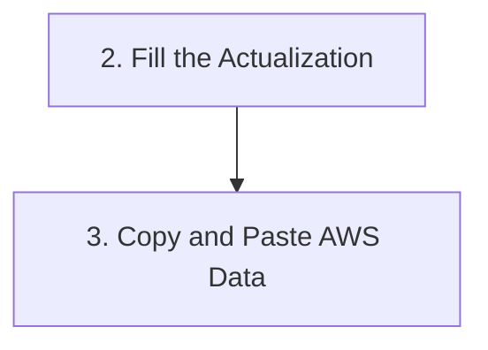

# 15 - Provenance and Document Format

The core of the v2 design is a single rule: **every content line in the generated SOP carries
exactly one attribution.** Nothing unattributed. This document specifies the attribution grammar,
how it's enforced, and the markdown format it renders into. See `14-writer-reviewer-checker.md`
for the pipeline that produces it.

## The attribution grammar

Three tags, each meaning something specific and mutually exclusive:

- `` `[said @t]` `` -- this content was stated in narration at timestamp `t`. Written by the Writer
  (`core/llm/prompts.py: WRITER_SYSTEM`), one per step minimum, each linking back to the transcript
  segment(s) it came from (`Attribution.segment_ids`).
- `` `[inferred from screen @t]` `` -- this content was resolved by the Checker from video frames,
  visibly tagged as an inference, never silently promoted to stated fact. Added in Phase 3 as a
  step's `InferredClause`, kept separate from the step's original `instruction` text rather than
  merged into it -- see "Why augment, don't rewrite" below.
- `flag_id` (e.g. `FLAG-01`) -- an open question the Reviewer raised, referencing a `Flag` with a
  `status` of `open | resolved | contradicted | unresolvable | unchecked | check_failed` and a
  window (`window_segment_ids` or `window_time_range`) a human can go check. **Not rendered as an
  inline callout under a step any more** -- see "Rendering" below for where each status actually
  ends up; the four-section restructure moved flags out of the step stream entirely.
- `StepTransition.quote` -- not a fourth attribution tag, but the same grounding principle applied
  to the Reviewer: a transition's `carries` claim only counts as coverage if `quote` is a verbatim,
  code-validated substring of the transcript (`core/llm/parsing.py: _quote_is_grounded`). An
  invented or paraphrased quote is treated exactly like an omitted transition. See
  `docs/18-known-gaps-v2.md` entry 1 for why this was added -- omission alone (no quote
  requirement) was measurably unstable across repeated runs of the same video.

Why this matters, concretely: it gives auditability (trace any line in the final document back to
its source -- a specific transcript moment or a specific frame), escalation quality (every open
flag ships with the time window a human should look at, not just a vague "this seems off"), and
future eval ground truth (flag + window + eventual human answer becomes a labeled training example).

## Why augment, don't rewrite

When the Checker resolves a flag, the resolution is added to the step as a separate
`InferredClause`, not spliced into `SOPStep.instruction`. Rendered, the two are kept visibly
separate rather than merged onto one line -- the narrated instruction stays in Section 1 ("The
workflow, as spoken"), unmodified, and the clause it earned appears in Section 2 ("What we
assumed"), naming which step it attaches to and which flag resolved it:

```markdown
## 1. The workflow, as spoken

### 2. Fill the Actualization
Fill the actualization by taking data from transactions.  `[said @0:07]`

## 2. What we assumed

- Step 2 (Fill the Actualization): data is taken from the 'Transactions - March' sheet
  `[inferred from screen @0:04, FLAG-02]`
```

But in the model, `instruction` stays exactly what the Writer wrote ("Fill the actualization by
taking data from transactions."), byte-stable
across the run. This matters for three reasons: the project owner's own session ritual is diffing
`sop.md` against the previous run, which only means something if the narrated text doesn't shift
underneath a Checker pass; the merge becomes reversible (a flag's resolution can be un-applied
without reconstructing the original wording); and it keeps Writer output and Checker output
separable in the model even after they're rendered together.

## Enforcement: the provenance validator

`core/models/sop.py: provenance_violations(doc)` is a pure predicate checking:

1. Every step has at least one attribution.
2. Every flag has a window (`window_segment_ids` or `window_time_range`).
3. A resolution with verdict `resolved`/`contradicted` has at least one evidence frame; a
   resolution with verdict `unresolvable` has a non-empty `reason` instead -- it cannot have
   evidence by definition, since the whole point of `unresolvable` is that nothing on screen
   settled the question. (This refines the original plan's blanket "no resolution without
   evidence," which would have made `unresolvable` impossible to express.)
4. Every `step.flag_ids` entry, `resolution.flag_id`, and `inferred_clause.flag_id` references a
   flag that actually exists in the document's flag registry.

`SOPDocument` runs this via `@model_validator(mode="after")`, and **raises** rather than setting a
soft flag -- an invalid `SOPDocument` cannot be constructed. This was a deliberate choice over a
settable `provenance_complete: bool` field (which the original plan mentioned alongside "fail loud
in tests" -- two different mechanisms for one invariant). Raising means:

- A Writer that omits an attribution fails at Writer construction, which is already the pipeline's
  one fatal stage (`core/pipeline.py: WriterFailedError`) -- the failure lands exactly where the
  plan says it should.
- Every downstream consumer (the renderer, later phases' merge and `build_spec` logic) can assume
  provenance holds without re-checking it.

`provenance_complete` still exists, but as a derived `@computed_field` property
(`not provenance_violations(self)`) -- it serializes into `sop.json`/`build_spec.json` so an
external auditor can check it without re-deriving the predicate, but it cannot be spoofed by input
since it is never a constructor argument.

## The timing-degraded escape hatch

One real failure mode this rule has to account for: `core/llm/parsing.py:
parse_sarvam_stt_result` degrades to a single whole-transcript segment
(`start=0.0, end=0.0`) when Sarvam's per-chunk timing is unusable. Every `[said @t]` in the
resulting document would then read `@0:00` -- technically satisfying the provenance validator
(every step still has an attribution) while being substantively misleading. `core/pipeline.py:
run_pipeline` detects this case explicitly (`len(transcript) == 1 and transcript[0].end_s == 0.0`),
records a `stt_timing_degraded` failure on the run's metrics, and sets
`SOPDocument.timing_degraded = True`, which the renderer turns into a banner at the top of the
document. This is the provenance rule failing loudly (a visible warning) instead of silently
(fabricated-looking timestamps) when the underlying data genuinely can't support real timestamps.

## Rendering: deterministic, not LLM-authored

`report/sop_render.py: render_sop_md` is a pure function of a validated `SOPDocument` -- the LLM
never emits markdown directly, only JSON matching the Pydantic contract. Three reasons: two sources
of truth (LLM-authored markdown and the validated model) would inevitably diverge; the Reviewer
needs to reference step ids that are guaranteed to exist in the model; and the diff-against-previous-run
ritual needs byte-deterministic output, which an LLM-authored blob cannot give run to run.

The document is organized into four sections, in this fixed order, plus an optional appendix.
Nobody re-watches the recording to catch what a bare status string glossed over, so each section
states plainly what it is showing rather than relying on the reader to notice -- see
`docs/16-prompt-guide.md` and `docs/18-known-gaps-v2.md` for why this replaced the earlier
one-stream-per-step layout, which interleaved narration, assumptions, and open questions at equal
visual weight.

1. **The workflow, as spoken** -- ordered steps carrying only `[said @t]` attributions, plus the
   `Process flow` mermaid diagram. Pure narration; no flag tags, no inferred text. A step with no
   `[said @t]` at all (every attribution is `kind="inferred"` -- a Checker-inserted structural step
   nobody actually narrated) is marked `_(not narrated -- see Section 2)_` rather than rendered as
   if it were spoken.
2. **What we assumed** -- every `InferredClause` and every wholly-inferred step, each naming the
   flag it came from. This is the "accept or reject this claim" section.
3. **What is missing, or might be** -- flags grouped by *why* they're unanswered, since the groups
   mean different things: **Contradicted** (narration and screen disagree -- both versions shown
   side by side), **Unresolvable** (checked against the video, genuinely unanswered), and **Not
   checked** (`unchecked`/`check_failed` -- a pipeline limitation, explicitly labelled as not a
   confirmed gap in the process). A reliability warning is prepended here when the Reviewer's two
   instruments disagree (rich ambiguity flags but zero transitions emitted) -- see
   `docs/18-known-gaps-v2.md` entry 1.
4. **Questions to ask** -- a flat, severity-ordered list of every non-`resolved` flag, each with
   its timestamp and step, written to be handed to the person who recorded the walkthrough as-is.
   This is the actual deliverable this whole grammar exists to produce.

A real example, rendered from an actual run (`runs/20260829-144441-5f7ec1/sop.json`) via the
current `render_sop_md`:

````markdown
# SOP -- english_hackathon_test.mp4
Run: 20260829-144441-5f7ec1

## 1. The workflow, as spoken

### 2. Fill the Actualization
Fill the actualization by taking data from transactions.  `[said @0:07]`

### Process flow


## 2. What we assumed

- Step 2 (Fill the Actualization): data is taken from the 'Transactions - March' sheet
  `[inferred from screen @0:04, FLAG-02]`

## 3. What is missing, or might be

### Unresolvable -- checked against the video, still unanswered

- **FLAG-01** (Which specific master file needs to be opened for the monthly actions?) -- The
  specific master file name is not mentioned in the visible content or narration.

### Not checked -- a pipeline limitation, not a confirmed gap in the process

- **FLAG-03** (Where specifically in the monthly actions should the AWS data be pasted?) -- not
  checked -- the check itself failed

## 4. Questions to ask

1. [blocking] Which specific master file needs to be opened for the monthly actions? (step
   step-01) @segment 0 `[FLAG-01]`
2. [blocking] Where specifically in the monthly actions should the AWS data be pasted? (step
   step-03) @segment 2 `[FLAG-03]`

## Appendix -- segments not converted to steps
- `@0:21` "<text>" -- <reason>
````

(Trimmed to the interesting rows -- the real output has all four steps and all four flags. Every
flag id stays visible across whichever sections it appears in, so an answer can always be traced
back to its source.)

Non-actionable transcript segments (small talk, pauses) are never silently dropped -- they're
listed in the appendix with their timestamp and a reason, and `core/llm/parsing.py:
build_sop_from_writer_output` mechanically checks that every input segment index appears in exactly
one of a step's attributions or the appendix, raising if any segment is unaccounted for.
